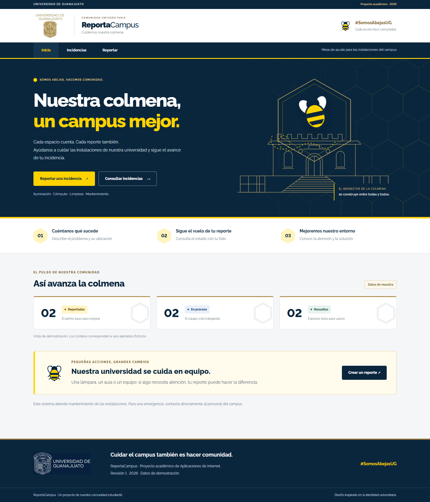
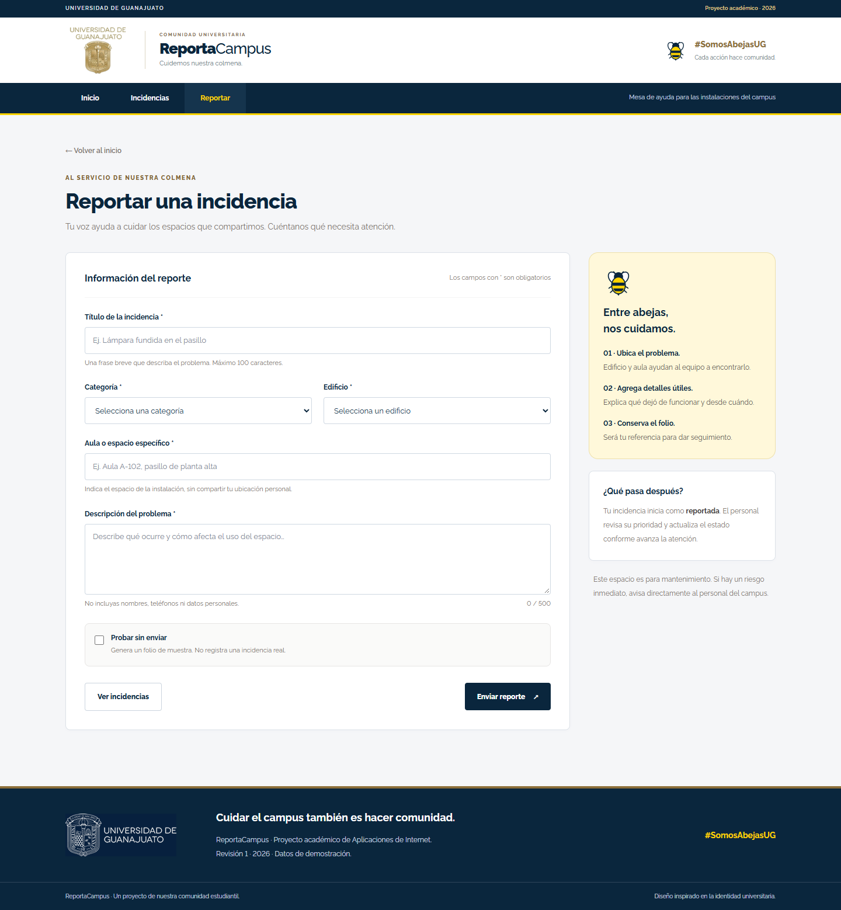
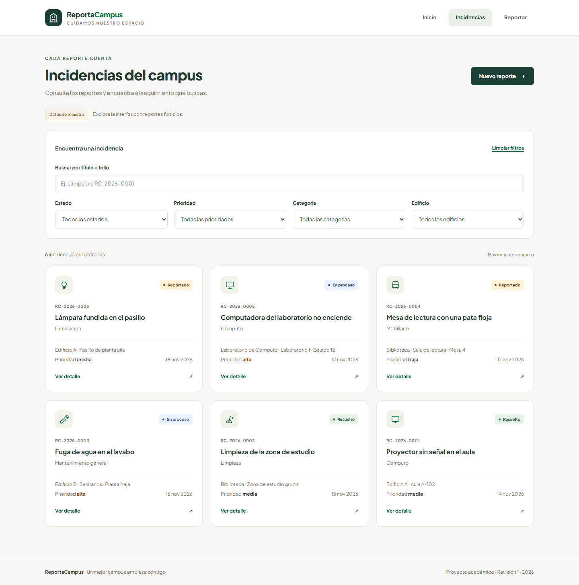
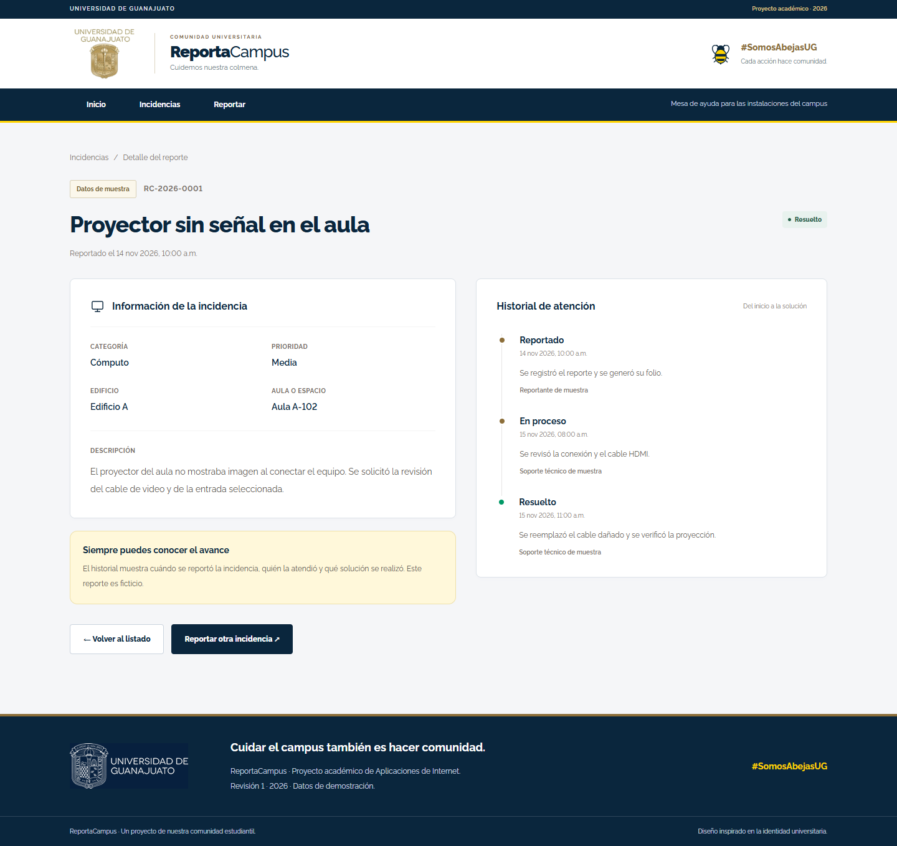

# Capturas de frontend · revisión 1

Responsable: Juan Manuel Razo Gayosso. Capturas del 18 de noviembre de 2026.
Generadas desde la aplicación en un navegador Edge/Chromium real en modo headless.
Los archivos son capturas de página completa, por eso su altura puede exceder
el alto de la ventana. Los datos mostrados son ficticios.

| Pantalla | Escritorio (1440 px de ancho) | Móvil (390 px de ancho) |
|---|---|---|
| Inicio | [Ver](inicio-escritorio.png) | [Ver](inicio-movil.png) |
| Reportar | [Ver](reportar-escritorio.png) | [Ver](reportar-movil.png) |
| Incidencias | [Ver](incidencias-escritorio.png) | [Ver](incidencias-movil.png) |
| Detalle con historial | [Ver](detalle-escritorio.png) | [Ver](detalle-movil.png) |

Estados e interacciones adicionales, a 390 px:

- [Menú móvil abierto](menu-movil-abierto.png)
- [Validación del formulario vacío](formulario-validacion.png)
- [Confirmación de demostración, sin guardado real](formulario-demostracion.png)
- [Listado sin coincidencias](listado-sin-resultados.png)
- [Incidencia no encontrada](detalle-no-encontrado.png)

## Vista rápida

## Repetir la comprobación

Seguir la [guía de pruebas manuales](../../pruebas/manuales.md) y tomar nuevas
capturas en otra carpeta si cambia la interfaz. Estas imágenes conservan la
evidencia original de Revisión 1. La distribución académica ya no requiere npm.
