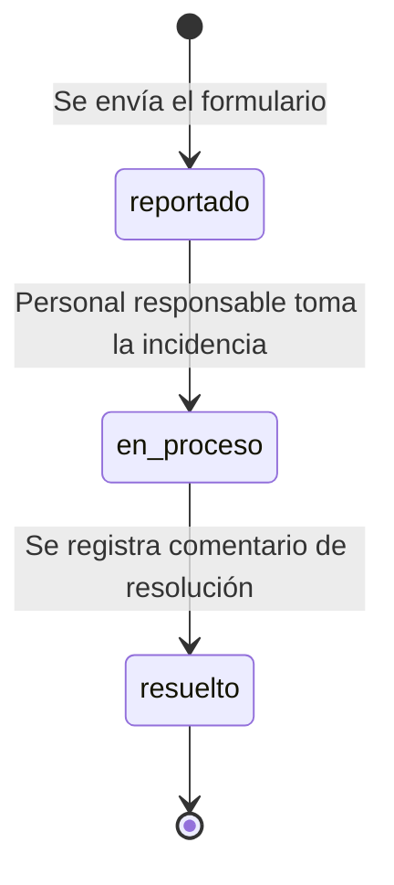

# Estados y prioridades: ReportaCampus

## 1. Estados de una incidencia

| Estado | Valor en Firestore | Significado |
|---|---|---|
| Reportado | `reportado` | La incidencia fue registrada y aún nadie la atiende. Es el estado inicial. |
| En proceso | `en_proceso` | El personal responsable ya la tomó y la está atendiendo. |
| Resuelto | `resuelto` | La incidencia fue atendida y cerrada. Es el estado final. |

### Diagrama de transiciones

### Transiciones permitidas

| Desde | Hacia | Quién puede | Condición |
|---|---|---|---|
| (nuevo) | `reportado` | Reportante | Formulario válido; se genera el folio |
| `reportado` | `en_proceso` | Personal responsable, administrador | Se asigna `responsableId` y se registra el movimiento |
| `en_proceso` | `resuelto` | Personal responsable, administrador | **Comentario de resolución obligatorio** |

### Transiciones no permitidas

- Saltar de `reportado` a `resuelto` directamente.
- Retroceder a un estado anterior (por ejemplo, de `resuelto` a `en_proceso`).
- Cambiar el estado de una incidencia ya `resuelta`.
- Que un reportante cambie el estado de cualquier incidencia.

## 2. Prioridades

| Prioridad | Valor en Firestore | Criterio | Ejemplo |
|---|---|---|---|
| Baja | `baja` | No afecta las actividades ni la seguridad; puede esperar. | Una luminaria fundida en un pasillo poco usado |
| Media | `media` | Afecta parcialmente el uso de un espacio, pero hay alternativa. | Una computadora de un laboratorio que no enciende |
| Alta | `alta` | Impide el uso de un espacio o puede causar un riesgo. | Un salón sin luz o un enchufe dañado |

**Regla inicial:** la prioridad por defecto es `media`. El personal responsable puede ajustarla al revisar la incidencia.

> Una emergencia real (incendio, lesiones, riesgo inmediato) **no** se gestiona en este sistema. Está fuera del alcance del proyecto.

## 3. Datos que se guardan en cada cambio de estado

Cada transición crea un documento en `incidencias/{id}/historial_estados` con:

| Campo | Descripción |
|---|---|
| `estadoAnterior` | Estado antes del cambio |
| `estadoNuevo` | Estado después del cambio |
| `responsableId` | Identificador del usuario que hizo el cambio |
| `comentario` | Texto del responsable (obligatorio al resolver) |
| `fecha` | Fecha y hora del cambio (marca de tiempo del servidor) |

## 4. Reglas que aplican las historias de usuario

- **HU-01:** toda incidencia nueva nace en `reportado`.
- **HU-04:** solo el personal autorizado cambia el estado, y solo en el orden permitido.
- **HU-04:** nunca se pasa a `resuelto` sin comentario.
- **HU-05:** el panel cuenta las incidencias por estado y calcula la antigüedad de las que siguen abiertas (`reportado` y `en_proceso`).

## 5. Antigüedad de las incidencias abiertas

| Rango | Etiqueta |
|---|---|
| Menos de 3 días | Reciente |
| De 3 a 7 días | Atención |
| Más de 7 días | Rezagada |

La antigüedad se calcula como la diferencia entre la fecha actual y `fechaCreacion`.

## 6. Permisos previstos por rol

Esta matriz describe el comportamiento esperado del MVP según las historias de
usuario. La autenticación y la autorización real se integran en la Revisión 2.
No acredita que estos permisos ya estén implementados.

| Operación | Reportante | Responsable | Admin |
|---|---|---|---|
| Crear una incidencia en `reportado` | Propia | Según el flujo de reporte | Según el flujo de reporte |
| Consultar listado, detalle e historial | Solo incidencias propias | Todas | Todas |
| Cambiar estado o ajustar prioridad | No | Sí | Sí |
| Modificar categorías, edificios o roles | No | No | Sí |
| Consultar el dashboard (Revisión 3) | No | Sí | Sí |

Al iniciar la atención se guarda `responsableId`. Cada cambio actualiza
`fechaActualizacion` y registra el movimiento en `historial_estados`.
Al resolver también se guarda `fechaResolucion`. El cambio y su historial deben
confirmarse juntos: si falla la operación, se conserva el estado anterior.
Las fechas reales deben usar marcas de tiempo del servidor.

## 7. Casos de prueba del flujo

| Caso | Acción | Resultado esperado |
|---|---|---|
| E-01 | Crear un reporte válido | Estado `reportado`, prioridad inicial `media` y folio único |
| E-02 | Un responsable toma un reporte | Pasa a `en_proceso`, con responsable e historial |
| E-03 | Resolver desde `en_proceso` con comentario | Pasa a `resuelto`, con fecha de resolución e historial |
| E-04 | Intentar pasar de `reportado` a `resuelto` | Se rechaza y no se modifica la incidencia |
| E-05 | Intentar retroceder o cambiar una incidencia resuelta | Se rechaza y no se agrega un movimiento |
| E-06 | Un reportante intenta cambiar estado o prioridad | Se rechaza también desde Firestore |
| E-07 | Resolver con comentario vacío o solo espacios | Se rechaza y permanece `en_proceso` |
| E-08 | Falla el guardado de estado e historial | No queda un cambio parcial |

Estos casos quedan como plan para la integración real; no se han ejecutado contra
Firestore. La Revisión 1 permite mostrar el diagrama y los historiales ficticios.

## 8. Datos de muestra de la Revisión 1

Se reutilizan los ejemplos que Juan Manuel incorporó en
[`public/js/demo-data.js`](../public/js/demo-data.js). Se evita duplicar el
catálogo que ya consumen el listado y el detalle.

| Folio | Estado | Prioridad | Ubicación |
|---|---|---|---|
| RC-2026-0006 | `reportado` | `media` | Edificio A |
| RC-2026-0005 | `en_proceso` | `alta` | Laboratorio de Cómputo |
| RC-2026-0004 | `reportado` | `baja` | Biblioteca |
| RC-2026-0003 | `en_proceso` | `alta` | Edificio B |
| RC-2026-0002 | `resuelto` | `media` | Biblioteca |
| RC-2026-0001 | `resuelto` | `media` | Edificio A |

Los ejemplos cubren los tres estados y las tres prioridades. Su historial usa
`responsable` como etiqueta de presentación y fechas ISO; no equivale a la
subcolección real, que requiere `responsableId`, `estadoAnterior` y timestamps
según [`modelo-datos.md`](modelo-datos.md). No deben cargarse directamente en
Firestore como si fueran documentos completos del modelo.
