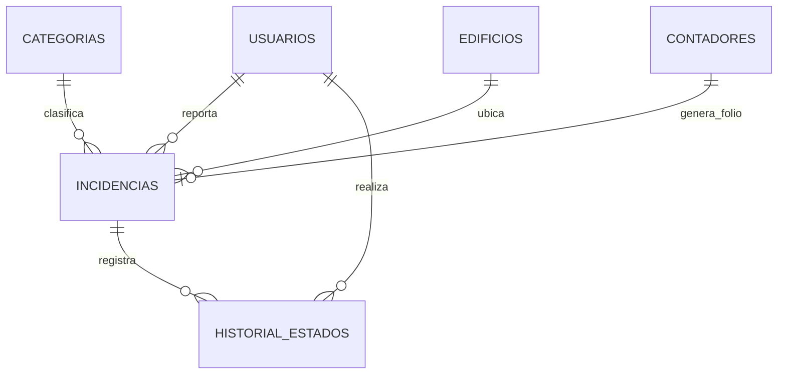

# Modelo de datos: ReportaCampus

Base de datos: **Cloud Firestore** (NoSQL, documentos y colecciones).
Autenticación: **Firebase Authentication** (correo y contraseña).

## 1. Vista general



| Colección | Propósito |
|---|---|
| `usuarios` | Perfil y rol de cada persona autenticada |
| `categorias` | Catálogo de tipos de incidencia |
| `edificios` | Catálogo de edificios y sus aulas |
| `incidencias` | Reportes registrados |
| `incidencias/{id}/historial_estados` | Subcolección con los cambios de estado |
| `contadores` | Contador para generar folios únicos |

## 2. Colecciones y campos

### 2.1 `usuarios`
El ID del documento es el **UID** de Firebase Authentication.

| Campo | Tipo | Obligatorio | Descripción |
|---|---|---|---|
| `nombre` | string | Sí | Nombre para mostrar |
| `correo` | string | Sí | Correo con el que inicia sesión |
| `rol` | string | Sí | `reportante`, `responsable` o `admin` |
| `fechaRegistro` | timestamp | Sí | Fecha de alta |

### 2.2 `categorias`

| Campo | Tipo | Obligatorio | Descripción |
|---|---|---|---|
| `nombre` | string | Sí | Ej.: Iluminación, Cómputo, Limpieza, Mantenimiento |
| `descripcion` | string | No | Explicación breve |
| `activa` | boolean | Sí | Si se puede elegir en el formulario |

### 2.3 `edificios`

| Campo | Tipo | Obligatorio | Descripción |
|---|---|---|---|
| `nombre` | string | Sí | Ej.: Edificio A |
| `aulas` | array de strings | No | Lista de aulas o espacios del edificio |
| `activo` | boolean | Sí | Si se puede elegir en el formulario |

### 2.4 `incidencias`

| Campo | Tipo | Obligatorio | Descripción |
|---|---|---|---|
| `folio` | string | Sí | Identificador legible y único, ej.: `RC-2026-0001` |
| `titulo` | string | Sí | Resumen corto (máx. 100 caracteres) |
| `descripcion` | string | Sí | Detalle del problema (máx. 500 caracteres) |
| `categoriaId` | string | Sí | ID del documento en `categorias` |
| `edificioId` | string | Sí | ID del documento en `edificios` |
| `aula` | string | Sí | Aula o espacio dentro del edificio |
| `prioridad` | string | Sí | `baja`, `media` o `alta` (por defecto `media`) |
| `estado` | string | Sí | `reportado`, `en_proceso` o `resuelto` |
| `reportanteId` | string | Sí | UID de quien reportó |
| `responsableId` | string | No | UID de quien la atiende (se llena al pasar a `en_proceso`) |
| `fechaCreacion` | timestamp | Sí | Marca de tiempo del servidor |
| `fechaActualizacion` | timestamp | Sí | Última modificación |
| `fechaResolucion` | timestamp | No | Se llena al pasar a `resuelto` |

### 2.5 `incidencias/{id}/historial_estados` (subcolección)

| Campo | Tipo | Obligatorio | Descripción |
|---|---|---|---|
| `estadoAnterior` | string | Sí | Estado antes del cambio (`null` en la creación) |
| `estadoNuevo` | string | Sí | Estado después del cambio |
| `responsableId` | string | Sí | UID de quien hizo el cambio |
| `comentario` | string | Condicional | Obligatorio cuando `estadoNuevo` es `resuelto` |
| `fecha` | timestamp | Sí | Marca de tiempo del servidor |

### 2.6 `contadores`
Un solo documento por año, por ejemplo `contadores/folios-2026`.

| Campo | Tipo | Descripción |
|---|---|---|
| `ultimoFolio` | number | Último número asignado |

## 3. Generación del folio

El folio se arma así: `RC-` + año + `-` + número con 4 dígitos (`RC-2026-0001`).

Para que **nunca se repita**, aunque dos personas envíen un reporte al mismo tiempo, se usa una **transacción de Firestore** (`runTransaction`) que, en una sola operación:

1. Lee `contadores/folios-2026`.
2. Suma 1 a `ultimoFolio`.
3. Guarda el contador actualizado.
4. Crea la incidencia con el folio nuevo.

Si la transacción falla, no se guarda nada: ni el folio ni la incidencia.

## 4. Datos de ejemplo (semilla)

**`categorias`**: Iluminación, Cómputo, Limpieza, Mantenimiento, Mobiliario.

**`edificios`**: Edificio A (aulas A101, A102, A201), Edificio B (aulas B101, B102), Biblioteca, Laboratorio de cómputo.

**`incidencias`** (ejemplo):
```json
{
  "folio": "RC-2026-0001",
  "titulo": "Luminaria fundida en el pasillo",
  "descripcion": "La lámpara del pasillo del segundo piso no enciende.",
  "categoriaId": "iluminacion",
  "edificioId": "edificio-a",
  "aula": "Pasillo planta alta",
  "prioridad": "baja",
  "estado": "reportado",
  "reportanteId": "uid-demo-1"
}
```

> Los datos semilla deben ser **ficticios**. No usen nombres, correos ni teléfonos reales.

## 5. Consultas principales

| Historia | Consulta |
|---|---|
| HU-02 | `incidencias` filtradas por `estado`, `prioridad`, `categoriaId` o `edificioId`, ordenadas por `fechaCreacion` descendente |
| HU-02 | Para un reportante: `incidencias` donde `reportanteId == uid` |
| HU-03 | Un documento de `incidencias` y su subcolección `historial_estados` ordenada por `fecha` ascendente |
| HU-05 | Conteo de `incidencias` por `estado`, y antigüedad calculada con `fechaCreacion` |

**Índices:** combinar varios filtros con ordenamiento puede pedir índices compuestos. Firestore muestra en la consola del navegador un enlace para crearlos con un clic.

## 6. Reglas de seguridad (resumen)

El detalle va en `firestore.rules` (lo trabaja E). Lo mínimo que debe cumplir el modelo:

- Un reportante solo lee y crea sus propias incidencias.
- Solo `responsable` y `admin` actualizan el `estado` y escriben en `historial_estados`.
- Solo `admin` modifica `categorias`, `edificios` y roles de `usuarios`.
- Nunca se usa `allow read, write: if true`.